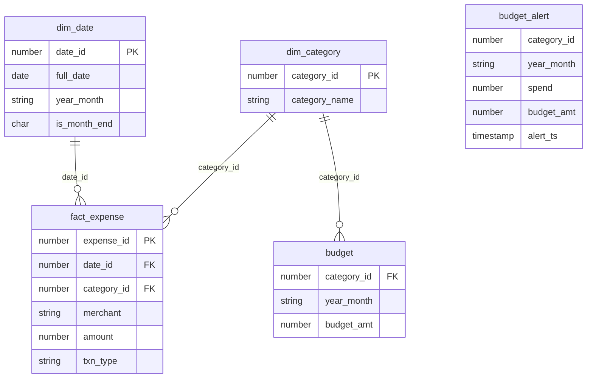

# Star schema

Amount is signed: refunds are negative.

# KPIs
| KPI | Definition |
|---|---|
| Net Spend | SUM(purchases) - SUM(refunds) |
| Budget Utilisation % | Net Spend / monthly category budget |
| Breach Flag | Utilisation > 100% |
| MoM Change % | (This month - last month) / last month |
| Uncategorised % | Uncategorised rows / all rows |
